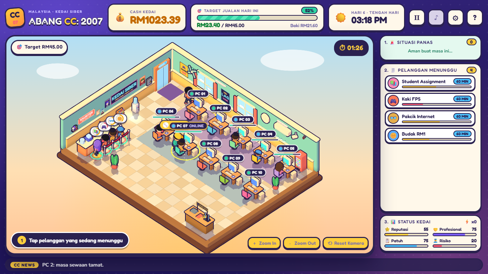

# Tenang Squad

### Calm hands. Chaotic games. 🎮

*Sekumpulan 'almost' 30an · Dulu bermain, sekarang mencipta · **Enjoy Bersama!***

[🌐 Website](https://tenangsquad.github.io/TenangSquad/) &nbsp;·&nbsp; [▶ Play ABANG CC: 2007](https://tenangsquad.github.io/TenangSquad/play/abang-cc/) &nbsp;·&nbsp; [🕹️ Game source](https://github.com/tenangsquad/abangcc)

---

## 👋 Hi, kami Tenang Squad

Geng kawan-kawan yang dulu kerjanya *"satu round lagi"* sampai subuh. Sekarang umur dah **'almost' 30an**: belakang mula sakit, tapi semangat masih level 99. Daripada kutip markah dalam game orang lain, kami mula bina game sendiri, sebab **seronok**.

*Tenang* means **calm** in Malay. We're an indie game squad (est. 2022) making cozy, funny, Malaysian-flavoured games that play right in your browser. No download, no sign-up.

---

## 🚀 What we've made

### 🖥️ ABANG CC: 2007 &nbsp;`Alpha 0.13`
> *Run a cozy cyber café in Malaysia, 2007.*

Seat the customers · fix the crashing PCs · catch the cheaters · survive the blackout · hit the daily target.

A real-time 3D cartoon management game with 9 customer types, 9 special events and 13 upgrade perks, and every perk has a downside. It plays on desktop and on phones held sideways, and it saves your progress in the browser.

**[▶ Play it now](https://tenangsquad.github.io/TenangSquad/play/abang-cc/)** &nbsp;·&nbsp; [Source on GitHub](https://github.com/tenangsquad/abangcc)

### 🌐 The Tenang Squad website
The showcase page for who we are and what we make: the game, how it plays, screenshots, and the story of the squad. It's a plain HTML, CSS and JS site (no build step, no dependencies) and it's in this repo. See [SITE_README.md](SITE_README.md) for how it's put together.

---

## 🗺️ What's next

> Plans change. This is the honest "maybe soon" list, not a promise.

### ABANG CC: 2007
- [ ] **Phone check on real devices.** The sideways-phone layout is the least tested part.
- [ ] **New perks:** gaming headset rental, loyalty card (*Kad Prepaid*), a weekly cleaner, a Touch'n Go-style card reader.
- [ ] **New customers and events:** the ice-kacang delivery boy, a cyber-date drama, a village-head inspection, heavy rain with a leaky roof.
- [ ] **Longer game:** milestones beyond day 20 so the long run doesn't feel like a grind, and hats you unlock for *moments*, not only for clearing days.
- [ ] **Save export / import,** so progress can move between devices.
- [ ] **Polish:** more customer variety, day-1 hints, colour-blind-friendly indicators and a bigger-text option, and more sound.

### Website
- [ ] Add the squad's team and contact links.
- [ ] A Bahasa Melayu / English toggle.
- [ ] A custom domain.

### Game #2 🤫
Something new is being cooked. We'll show it on the website first.

---

## 💬 Come hang out

Played the game? Found a bug? Got an idea for a new customer or a cursed perk? Open an issue on the [game repo](https://github.com/tenangsquad/abangcc/issues). Feedback shapes what we build next.

*Made with ☕ and too many late nights at the kedai siber.*

