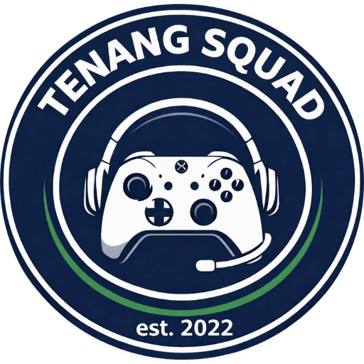
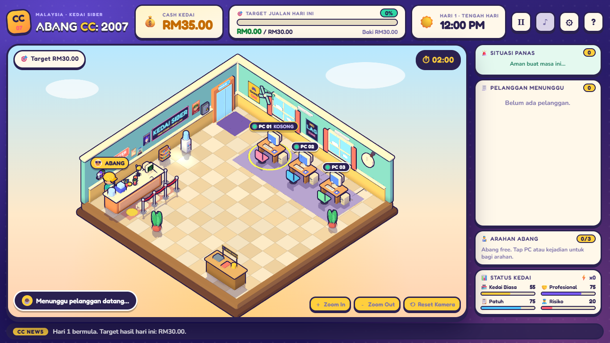

<div align="center">



# Tenang Squad

### Calm hands. Chaotic games.

**Sekumpulan 'almost' 30an · Dulu bermain, sekarang mencipta · Enjoy Bersama!** 🎮

[**▶ Play ABANG CC: 2007**](play/abang-cc/index.html) &nbsp;·&nbsp; [**🌐 Visit the website**](https://tenangsquad.github.io/TenangSquad/) &nbsp;·&nbsp; [**🕹️ Game source**](https://github.com/tenangsquad/abangcc)

</div>

---

## 👋 Siapa kami · Who we are

**Tenang Squad** ialah geng kawan-kawan yang dulu kerjanya *"satu round lagi"* sampai subuh. Sekarang umur dah **'almost' 30an**: belakang mula sakit, tapi semangat masih level 99. Daripada kutip markah dalam game orang lain, kami mula bina game sendiri, sebab **seronok**.

*Tenang* is Malay for **calm**. We're an indie game squad (est. 2022) making cozy, funny, Malaysian-flavoured games that run right in your browser. No download, no sign-up.

## 🎮 Games

| | Game | Status |
|:-:|---|---|
| 🖥️ | **[ABANG CC: 2007](play/abang-cc/index.html)**<br>Run a cozy cyber café in Malaysia, 2007. Seat the customers, fix the crashing PCs, catch the cheaters, survive the blackout. | **Playable** · Alpha 0.13 · desktop and phone (landscape) |
| ❓ | **Game #2** | In the workshop. Details soon. |

<div align="center">

</div>

## 🌐 About this repo

This repository holds the **Tenang Squad showcase website**: a plain HTML, CSS and JS page with no build step and no dependencies.

```
index.html            the website
css/  js/  img/       styles, script, logo and screenshots
play/abang-cc/        a playable copy of the game (single-file build)
SITE_README.md        notes for editing the site
```

**Run it locally:** open `index.html` in a browser, or serve the folder with `npx serve .` or `python -m http.server`.

**Host it:** any static host works. On GitHub, turn on *Settings → Pages → Deploy from a branch → `main` / root*. The site is then served at `tenangsquad.github.io/TenangSquad/`. All paths are relative, so it works from that sub-folder.

To update the game on the site or add the next one, see [SITE_README.md](SITE_README.md).

---

<div align="center">

*Made with ☕ and too many late nights at the kedai siber.*

</div>
